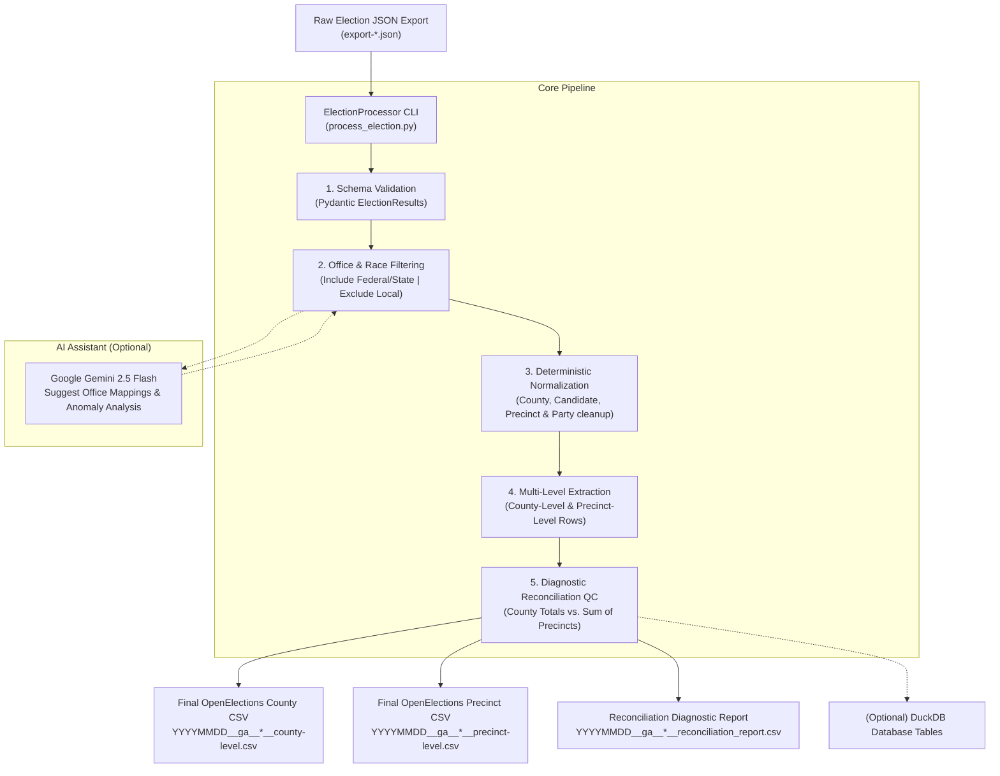

# OpenElections Georgia — Enhanced Voting Results Processor

A unified, high-performance CLI pipeline for standardizing Georgia election results directly from raw Secretary of State / Enhanced Voting JSON exports into canonical OpenElections CSVs (`county-level.csv`, `precinct-level.csv`), complete with automated Federal/State race filtering, privacy-safe vote-method extraction, non-blocking reconciliation QC, and optional Google Gemini AI assistance.

---

## Table of Contents
1. [Overview & Architecture](#1-overview--architecture)
2. [How Office Filtering Works](#2-how-office-filtering-works)
3. [Output Schemas & Vote-Method Breakouts](#3-output-schemas--vote-method-breakouts)
4. [Reconciliation & Quality Control](#4-reconciliation--quality-control)
5. [Google Gemini AI Assistant](#5-google-gemini-ai-assistant)
6. [CLI Reference & Options](#6-cli-reference--options)
7. [Step-by-Step Usage Guide](#7-step-by-step-usage-guide)
8. [Testing & Linting](#8-testing--linting)
9. [Directory & File Layout](#9-directory--file-layout)

---

## 1. Overview & Architecture

Previously, standardizing election results required multiple disconnected steps:
1. Running a Jupyter notebook (`load_json.ipynb`) with an interactive file chooser.
2. Generating intermediate flattened JSON files on disk.
3. Loading intermediate JSONs into DuckDB and manually executing multi-step SQL scripts (`jun2025_psc_special_election_county.sql`).
4. Manually updating SQL strings for office/party cleanup and running `COPY` commands.

### The Streamlined Pipeline
The processor replaces the multi-stage workflow with a single deterministic pipeline:



---

## 2. How Office Filtering Works

OpenElections tracks **Federal and State offices** in Georgia. In major or municipal elections, state JSON exports often bundle county and local ballot items (e.g. `Tax Commissioner`, `Mayor`, `Sheriff`, `Board of Education`, `SPLOST` referendums) that are excluded by default.

### Classification Precedence (`cleaner.py`)
Each raw office string is classified deterministically against [`cleaning_rules.yaml`](cleaning_rules.yaml) in the following order:

1. **Exact Overrides (`office_overrides`)** — Immediately classified as `[INCLUDED]` using the configured canonical office, district, and optional party hint.
2. **Canonical Office Patterns (`office_patterns`)** — Allow-list regex patterns for the 19 standard OpenElections Georgia offices (with automatic district extraction):
   - **Federal**: `President`, `Vice President`, `U.S. Senate`, `U.S. House`
   - **State Executive**: `Governor`, `Lieutenant Governor`, `Secretary of State`, `Attorney General`, `State School Superintendent`, `Commissioner of Agriculture`, `Commissioner of Insurance`, `Commissioner of Labor`, `Public Service Commissioner`
   - **State Legislative**: `State Senate`, `State House`
   - **State Judicial**: `Supreme Court Justice`, `Appeals Court Judge`, `Superior Court Judge`, `District Attorney`
3. **Direct Canonical Match (`canonical_offices`)** — If the raw string already matches one of the 19 canonical office names, it is `[INCLUDED]` with an empty district.
4. **Known Local / Municipal Patterns (`excluded_local_patterns`)** — Block-list patterns (e.g. `Tax Commissioner`, `Sheriff`, `Coroner`, `County Commission`, `Mayor`, `City Council`, `Board of Education`, `SPLOST`, `Referendum`, `Probate`, alcohol/tax questions) are categorized as `[EXCLUDED - NON-FEDERAL/STATE]` and dropped by default.
5. **Unrecognized Races (`UNMAPPED`)** — Any office matching neither allow-list nor block-list is flagged as `[UNMAPPED]` (and dropped unless `--all-offices` is passed or an override is added).
6. **Optional Local Inclusion (`--all-offices`)** — Includes all races (preserving raw office titles for non-canonical contests).

---

## 3. Output Schemas & Vote-Method Breakouts

CSV columns are chosen dynamically based on whether the source JSON includes vote-method breakdowns (`groupResults`):

- **When vote-method breakdowns are present:**
  - **County-level CSV** (`precinct = not available`):
    `county, precinct, office, district, party, candidate, votes, election_day_votes, advanced_votes, absentee_by_mail_votes, provisional_votes`
  - **Precinct-level CSV**:
    `county, precinct, office, district, party, candidate, votes, election_day_votes, advanced_votes, absentee_by_mail_votes, provisional_votes`
- **When no vote-method breakdowns are present (totals-only exports):**
  - Both CSVs use: `county, precinct, office, district, party, candidate, votes`

### Privacy-Suppressed Breakdowns
Georgia SOS / Enhanced Voting hides vote-method counts (`voteCount: null`, displayed as `-` on the SOS website) when too few ballots were cast to protect voter privacy—this occurs frequently at the precinct level and occasionally at the county level in single-precinct counties.

- If **any** vote-method entry in a row's `groupResults` is `None` (or `groupResults` is empty), `extract_vote_groups()` returns `None`.
- Both county-level and precinct-level rows retain the certified total in `votes` and leave all four vote-method columns blank (`,,,,`), preventing fabricated `0`s or misattribution to `election_day_votes`.
- If the source JSON has no `precinctResults`, precinct CSV and reconciliation report exports are skipped cleanly.

---

## 4. Reconciliation & Quality Control

In Georgia SOS / Enhanced Voting exports, **precinct sums occasionally differ slightly from county totals**:
- Very small precincts may have even their total votes suppressed (`-` on SOS, `0` in JSON) for voter privacy.
- Certain ballot categories (such as countywide provisional, challenged, or overseas ballots) can be tabulated at the county level without precinct assignment.

### How QC is Handled
Instead of a rigid assertion that aborts export, [`reconciler.py`](reconciler.py) compares every county-candidate total against the sum of its precinct `votes`:
- $\text{Diff} = \text{County Total} - \sum(\text{Precincts})$
- `MATCH`: $\text{Diff} = 0$
- `EXPECTED_RESIDUAL`: $\text{Diff} > 0$ and ($\text{Diff} \le 15$ or coverage $\ge 90\%$)
- `DISCREPANCY`: Any larger or negative variance flagged for manual review
- The CLI prints a diagnostic summary table and writes a companion `*_reconciliation_report.csv` file (gitignored).

---

## 5. Google Gemini AI Assistant

The optional AI assistant ([`ai_assistant.py`](ai_assistant.py)) uses Google Gemini (`gemini-2.5-flash`) via `google-genai`:
- **Unmapped Office Resolution**: Triggered whenever unmapped offices are found and either `--ai` is passed or `GEMINI_API_KEY` is configured (in `enhanced_voting_process/.env`, environment variables, or `--api-key`). If `--ai` is passed without a key (or if the API call fails), it falls back cleanly to rule-based heuristics.
- **Rule Persistence (`--save-ai-rules`)**: Saves suggested office mappings into `office_overrides` in `cleaning_rules.yaml` for deterministic reuse on future runs.
- **Reconciliation Anomaly Assessment**: Runs when **both** `--ai` is passed and `GEMINI_API_KEY` is available, and at least one contest is flagged `DISCREPANCY`.

---

## 6. CLI Reference & Options

Run the CLI from the repository root using `uv run python enhanced_voting_process/process_election.py [OPTIONS]`:

```text
usage: process_election.py [-h] -i INPUT [-o OUTDIR] [--inspect] [--ai]
                           [--save-ai-rules] [--all-offices]
                           [--duckdb DUCKDB] [--rules RULES]
                           [--api-key API_KEY]

OpenElections Georgia Voter Results Processor

options:
  -h, --help            show this help message and exit
  -i INPUT, --input INPUT
                        Path to raw JSON election export file
  -o OUTDIR, --outdir OUTDIR
                        Output directory for generated CSV files (defaults to input dir)
  --inspect             Inspect / dry-run mode (does not write CSVs)
  --ai                  Enable Gemini AI assistant for mappings & anomaly analysis
  --save-ai-rules       Auto-save AI approved mappings to cleaning_rules.yaml
  --all-offices         Process all offices (including non-standard local races)
  --duckdb DUCKDB       Optional path to DuckDB file to load cleaned tables
  --rules RULES         Custom path to cleaning_rules.yaml
  --api-key API_KEY     Google Gemini API Key (or set GEMINI_API_KEY env var)
```

---

## 7. Step-by-Step Usage Guide

### Step 1: Configure Gemini API Key (Optional)
```bash
cp enhanced_voting_process/.env.example enhanced_voting_process/.env
```
Edit `enhanced_voting_process/.env`:
```env
GEMINI_API_KEY="AIzaSy..."
```

### Step 2: Inspect a New File (Dry Run)
Verify detected races, excluded local contests, unmapped offices, and county-vs-precinct reconciliation without writing files:
```bash
uv run python enhanced_voting_process/process_election.py \
  --input ~/Development/openelections-sources-ga/2025/export-2025PSCPrimaryRunoff.json \
  --inspect
```

### Step 3: Run with AI Assistance (Optional)
If unrecognized office strings appear and you want Gemini to suggest and persist mappings:
```bash
uv run python enhanced_voting_process/process_election.py \
  --input ~/Development/openelections-sources-ga/2025/export-2025PSCPrimaryRunoff.json \
  --ai \
  --save-ai-rules
```

### Step 4: Generate Final OpenElections CSVs
Produce county-level CSV, precinct-level CSV, and reconciliation diagnostic CSV:
```bash
uv run python enhanced_voting_process/process_election.py \
  --input ~/Development/openelections-sources-ga/2025/export-2025PSCPrimaryRunoff.json \
  --outdir ./2025/
```

### Step 5: Load into DuckDB (Optional)
Insert the generated CSVs into tables (`<tbl_base>_county` and `<tbl_base>_precinct`) in a DuckDB database. If the database is locked by another tool (e.g., DataGrip or DBeaver), CSV export still succeeds and a warning is printed:
```bash
uv run python enhanced_voting_process/process_election.py \
  --input ~/Development/openelections-sources-ga/2025/export-2025PSCPrimaryRunoff.json \
  --outdir ./2025/ \
  --duckdb 2025/code/openelections_2025.duckdb
```

---

## 8. Testing & Linting

Run unit tests (`tests/test_cleaner.py`, `tests/test_process_election.py`) and PEP 8 linting from the repository root:

```bash
# Unit tests
uv run pytest -v

# Linting (79-char line limit)
uv run flake8 enhanced_voting_process/ tests/
```

*(If invoking after moving the repo directory, run `uv sync` first or use `uv run python -m pytest -v` / `uv run python -m flake8 enhanced_voting_process/ tests/`.)*

---

## 9. Directory & File Layout

```text
enhanced_voting_process/
├── __init__.py             # Package marker
├── process_election.py     # Main CLI entrypoint (ElectionProcessor)
├── cleaner.py              # Office classification & string normalization engine
├── reconciler.py           # County vs. Precinct diagnostic reconciliation QC
├── ai_assistant.py         # Optional Google Gemini integration & heuristic fallback
├── cleaning_rules.yaml     # Canonical offices, party map, regex rules & local exclusions
├── enhanced_json_model.py  # Pydantic schema validator for raw Enhanced Voting JSON
├── .env.example            # API key environment template
├── archived/               # Legacy notebooks and SQL processing scripts
└── README.md               # Pipeline documentation
```
